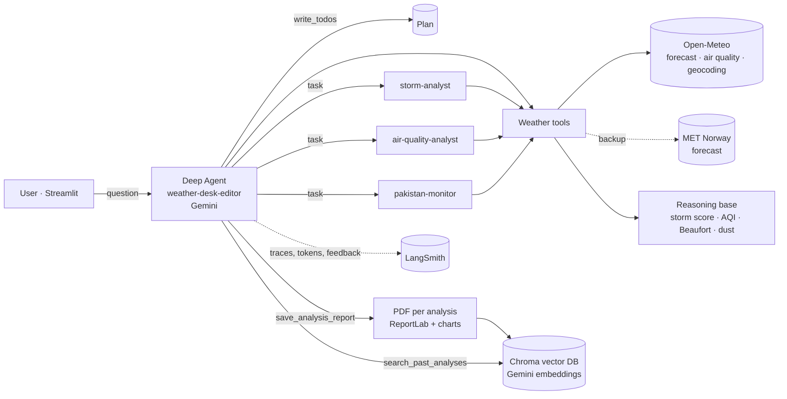

# ⛈️ NeuralCast — Weather Intelligence & Storm Prediction

**by Neural ThinkPad** · built by Khurram Shahzad

NeuralCast is a weather **portal** and a set of **AI weather agents** in one Streamlit app. Ask an agent
about any city and the whole portal (dashboard, cards, charts, earthquake panel, downloads) moves to that
city. It is built with **LangChain Deep Agents** and **Google Gemini**, and it:

- gives **live weather anywhere in the world** for a city: air (wind) speed, air direction, air humidity, air quality index (AQI), pressure and conditions
- **predicts rain and storms in the coming hours** from live forecast data: thunderstorms, wind storms and dust storms, scored 0–100 with Low / Moderate / High / Severe risk
- scans **Pakistani cities** for rain and storms in one call
- saves every analysis as its **own PDF named after the analysis**, ready for news feeds, and indexes it in a **Chroma vector database** for semantic search
- lets you **download reports** from the Streamlit web app
- is traced and evaluated with **LangSmith**: every run, sub-agent, tool call, latency and token count, plus an offline evaluation suite and 👍/👎 user feedback

---

## Weather API: Open-Meteo (free, no API key)

| Requirement | Open-Meteo field / endpoint |
|---|---|
| Live weather, any city in the world | `geocoding-api.open-meteo.com/v1/search` → `api.open-meteo.com/v1/forecast?current=…` |
| Air (wind) speed, gusts, direction | `wind_speed_10m`, `wind_gusts_10m`, `wind_direction_10m` |
| Air humidity | `relative_humidity_2m`, `dew_point_2m` |
| Air quality index | `air-quality-api.open-meteo.com/v1/air-quality`: `us_aqi`, `european_aqi`, `pm2_5`, `pm10`, `dust`, O₃, NO₂, SO₂, CO |
| Rain in the coming hours | hourly `precipitation_probability`, `precipitation`, `rain`, `showers` (`forecast_hours=1..72`) |
| Storm prediction | hourly WMO `weather_code` (95/96/99 = thunderstorm/hail), `cape`, `lifted_index`, `wind_gusts_10m`, `pressure_msl` |
| Many Pakistani cities at once | one request with comma-separated latitudes/longitudes |

Why Open-Meteo and not the others:

| API | Key needed | Hourly forecast | AQI | Storm indicators (CAPE / lifted index) | Free tier |
|---|---|---|---|---|---|
| **Open-Meteo** ✅ | No | Yes, 16 days | Yes | Yes | Free for non-commercial use (~10k calls/day) |
| OpenWeatherMap | Yes | Paid plans only | Yes | No | 1,000 calls/day for current weather |
| WeatherAPI.com | Yes | Yes | Yes (`aqi=yes`) | No | Limited monthly calls |
| Tomorrow.io | Yes | Yes | Paid | Partly | Low daily limits |

> Data licence: Open-Meteo data is CC BY 4.0. The app and PDFs credit "Weather data by Open-Meteo.com". Commercial use needs an Open-Meteo API subscription.

**Backup source — MET Norway.** Streamlit Community Cloud shares servers (and outgoing IP addresses) between many apps, and Open-Meteo occasionally stops answering them for a short while. The client then retries once, skips Open-Meteo for 60 s and loads the forecast from [MET Norway Locationforecast](https://api.met.no/weatherapi/locationforecast/2.0/documentation) (free, no key, CC BY 4.0), converted to the same shape. MET has no air quality, gusts or rain probability outside Scandinavia, so those show as unavailable and the dashboard says which source is in use. If both fail, the last good answer (up to 6 h old) is shown; otherwise the page shows the error and retries by itself every 20 s.

---

## Architecture



| Path | Responsibility |
|---|---|
| [app.py](app.py) | Streamlit UI: agent chat, live dashboard, Pakistan map, reports download, archive search, token usage |
| [weather_agent/agent.py](weather_agent/agent.py) | `create_deep_agent` with Gemini, prompts, 3 sub-agents |
| [weather_agent/tools.py](weather_agent/tools.py) | LangChain tools the agent calls |
| [weather_agent/analysis.py](weather_agent/analysis.py) | **Reasoning base**: storm score, rain intensity, AQI bands, Beaufort, wind compass, dust-storm rule |
| [weather_agent/weather_api.py](weather_agent/weather_api.py) | Open-Meteo client: 10-minute cache, retry, circuit breaker, backup and stale fallback |
| [weather_agent/met_norway.py](weather_agent/met_norway.py) | MET Norway backup forecast, converted to the Open-Meteo shape |
| [weather_agent/service.py](weather_agent/service.py) | City snapshot, Pakistan scan, rule-based summary |
| [weather_agent/reports.py](weather_agent/reports.py) | News-ready PDF (risk badge, analysis, tables, chart) |
| [weather_agent/vector_store.py](weather_agent/vector_store.py) | Chroma store for saved analyses |
| [weather_agent/usage.py](weather_agent/usage.py) | Token accounting across main agent and sub-agents |
| [weather_agent/ui/](weather_agent/ui/) | Dark/light theme tokens, animated SVG icons, HTML components, Altair charts |
| [weather_agent/ui/views/](weather_agent/ui/views/) | One module per tab (dashboard, radar, analyst, library, telemetry) |
| [evals/](evals/) | LangSmith dataset and evaluators |
| [tests/](tests/) | Offline tests, including the real agent graph driven by a scripted model |

### Storm reasoning base

The LLM never invents numbers. The tools compute these indicators and the agent explains them.

| Indicator | Thresholds |
|---|---|
| Thunderstorm | WMO codes 95, 96, 99 (96/99 with hail) |
| CAPE (J/kg) | <300 weak · 300–1000 moderate · 1000–2500 strong · >2500 extreme |
| Lifted index | >0 stable · 0…−3 marginal · −3…−6 unstable · <−6 very unstable |
| Gusts (km/h) | ≥50 strong · ≥62 gale · ≥89 storm |
| Rain rate (mm/h) | <2.5 light · 2.5–7.6 moderate · 7.6–50 heavy · >50 violent |
| Storm score → risk | <20 Low · 20–44 Moderate · 45–69 High · ≥70 Severe |
| Dust storm | strong wind + humidity <35–40 % + high PM10/dust |
| US AQI | 0–50 Good · 51–100 Moderate · 101–150 Sensitive · 151–200 Unhealthy · 201–300 Very unhealthy · 301+ Hazardous |

---

## Run locally

Use Python 3.12.

```powershell
python -m venv .venv
.\.venv\Scripts\Activate.ps1
pip install -r requirements-dev.txt
# open .env and fill in GOOGLE_API_KEY (and LANGSMITH_API_KEY if you want tracing)
streamlit run app.py
```

### API keys live in `.env`

All keys are read from the `.env` file in the project folder (template: [.env.example](.env.example)). `.env` is git-ignored, the app never shows a key in the UI, and there is no key input box. Real environment variables take precedence over `.env`. Restart the app after editing `.env`.

Keys:

- **Gemini**: free key at <https://aistudio.google.com/apikey>. Default model `gemini-3.5-flash-lite` (fastest and most available on the free tier); you can switch models in the sidebar's Configuration. Your current limits are shown at <https://aistudio.google.com/rate-limit>.
- **LangSmith** (optional): <https://smith.langchain.com> → Settings → API keys.

Without a Gemini key the live dashboard, Pakistan radar and rule-based PDF reports still work. The AI analyst and vector search need the key.

## The portal

**Sidebar (enterprise layout)**: Neural ThinkPad / NeuralCast brand and the owner's profile on top;
**agent selector**; **＋ New conversation**; **conversation history** (one click re-opens a chat, each
with its own agent memory); and at the bottom **⚙️ Configuration** with the Gemini model, ☀ light/dark
theme, system status of every data source and any error such as a missing API key. Branding can be
changed with `APP_COMPANY_NAME`, `APP_PRODUCT_NAME`, `APP_OWNER_NAME` in `.env`.

**Agents** (pick in the sidebar):

| Agent | Tools | Use for |
|---|---|---|
| ⛈️ Weather & Storm Agent | all tools + 3 sub-agents (storm, air quality, Pakistan) + planning | anything; full reports |
| 🇵🇰 Pakistan Storm Desk | Pakistan scan, rain/storm forecast, live weather | country-wide monitoring |
| 🌫️ Air Quality Analyst | air quality, live weather | AQI, smog, dust, health advice |
| 🌍 Seismic & Hazard Monitor | USGS earthquakes, live weather, storm forecast | earthquakes + concurrent storms |

**Command bar** (top of the page): 🔎 search any city with a "matches" picker, 🇵🇰 quick pick,
forecast window, recent searches as chips.

| Tab | What it shows |
|---|---|
| 🌤 Dashboard | Hero card with animated condition icon, storm-risk gauge, tiles for air speed & direction (compass), humidity, AQI, pressure, clouds, dust storm; hourly strip; 7-day outlook; analytics charts; **seismic activity** (USGS, 500 km, 7 days: KPIs, map, table); one-click PDF |
| 🤖 AI agent | Chat + **live context card** that follows the conversation; tool/sub-agent progress; tokens; per-answer **PDF** and **Markdown** downloads; 👍/👎 feedback |
| 🛰 Pakistan radar | Risk map, KPIs, city × hour heatmap, rankings, city board, earthquakes around Pakistan |
| 📥 Downloads | **Data exports** for the current city (hourly CSV, 7-day CSV, air-quality CSV, full JSON, earthquakes CSV), Pakistan scan CSV, conversation transcript, plus the searchable **PDF library** |
| 🔎 Archive | Semantic (vector DB) or keyword search over saved analyses |
| 📊 Telemetry | Everyone: their own token usage in this browser session. Owner: also the LangSmith usage meter and evaluation commands |

Data sources: **Open-Meteo** (weather, AQI, geocoding — free, no key), **MET Norway** (backup forecast — free, no key) and **USGS** earthquake catalogue (free, no key).

## Reliability: Gemini overloads

Free Gemini models are sometimes overloaded (HTTP 503 "high demand", 504 deadline exceeded, 429 rate
limit). This is on Google's side, not a key problem. The agent fails fast (60 s, no client retries),
**automatically falls back** to the next free model (`gemini-3.5-flash-lite → 3.6-flash → 3.8-flash →
3.1-flash-lite`, starting from whichever model is selected), resumes the interrupted run instead of starting over, and parks a busy model for
10 minutes. If every model fails, the answer explains why and shows a **🔁 Resend** button.

## Privacy: what visitors see vs. owner mode

The portal is public, so each visitor sees **only their own data**, identified by their browser session
(there is no login; a page refresh or a new tab starts a new session):

| Data | Public visitor | Owner (after unlocking) |
|---|---|---|
| Chats, token usage | Their own session | Their own session |
| PDF report library (Downloads) | Reports they created in this session | Every visitor's reports |
| Archive search (keyword + vector DB), agent's `search_past_analyses` | Their own analyses | Everything |
| LangSmith usage meter (all runs, tokens, success rate, latency, cost, raw errors) | Hidden | Shown in Telemetry |
| Evaluation commands, LangSmith project name, archive size, raw error details | Hidden | Shown |

**Owner mode:** set `ADMIN_PASSWORD` (at least 12 characters) in `.env` locally or in Streamlit Cloud
**Secrets**, never in GitHub. Then open *Configuration → Owner access* in the sidebar and unlock. The
password is compared in constant time and wiped from the session as soon as it is checked; wrong guesses pause sign-in
(5 per session → 5 minutes; 30 across the app in 10 minutes → paused for everyone). **🔒 Lock owner mode**
turns it off again; chats you had while unlocked stay in that browser tab, so close it on a shared
computer. Without `ADMIN_PASSWORD`, owner mode is simply unavailable. Trade-off: because the app-wide
pause also applies to you, someone guessing continuously can keep owner sign-in paused; use the
LangSmith website meanwhile, or change `ADMIN_PASSWORD` and reboot the app.

Reports and analyses are tagged with the creating session's random id. Older untagged reports are
owner-only. Every fallback attempt is its own LangSmith trace, so overloads are visible in the meter.

## Tests

```powershell
python -m pytest -q
```

The tests run offline. They cover the reasoning base, the Open-Meteo client (mocked HTTP), PDF generation, the Streamlit app (headless `AppTest`), and the **real Deep Agent graph** driven by a scripted chat model: tool calls, delegation to the `storm-analyst` sub-agent, PDF saving and token accounting.

## LangSmith evaluation

Tracing is automatic once `LANGSMITH_API_KEY` is set. Each chat run appears in the project with every sub-agent, tool call, latency and input/output token count. 👍/👎 buttons under answers record `user_rating` feedback on the trace.

Offline evaluation (7 behaviour tests, including an unknown city):

```powershell
python -m evals.run_eval                 # creates the dataset + experiment in LangSmith
python -m evals.run_eval --local --limit 3   # local run, nothing uploaded
```

| Evaluator | Measures |
|---|---|
| `tool_selection` | expected tools were called (main agent or sub-agents) |
| `mentions_city` | answer is about the requested place |
| `no_tool_errors` | no tool raised during the run |
| `coverage_judge` | Gemini LLM-as-judge: required facts covered, concrete numbers with units, no invented data |
| `total_tokens`, `llm_calls`, `latency_s` | cost and efficiency |

## Deploy on Streamlit Community Cloud (free)

1. Sign in at <https://share.streamlit.io> with the GitHub account that owns this repository.
2. **Create app** → **Deploy a public app from GitHub** → repository `khurramshahzad786/neuralcast-weather-agent`,
   branch `main`, main file `app.py`. Optionally choose a custom subdomain such as `neuralcast`.
3. **Advanced settings** → Python version **3.12**.
4. **Advanced settings → Secrets**: paste your keys (TOML format, see below) and click **Save**.
5. **Deploy**. The first build takes a few minutes because of `chromadb`. Later `git push`es redeploy automatically.

### Managing API keys securely on Streamlit Cloud

The repository contains **no keys**: `.env` and `.streamlit/secrets.toml` are in `.gitignore`, and only
templates with placeholders (`.env.example`, `.streamlit/secrets.toml.example`) are published.

On Streamlit Cloud the keys live in the app's encrypted **Secrets** store, never in GitHub:

```toml
# App → ⋮ → Settings → Secrets   (or Advanced settings → Secrets while creating the app)
GOOGLE_API_KEY = "your-real-gemini-key"
GEMINI_MODEL = "gemini-3.5-flash-lite"
GEMINI_EMBEDDING_MODEL = "models/gemini-embedding-001"

LANGSMITH_TRACING = "true"
LANGSMITH_API_KEY = "your-real-langsmith-key"
LANGSMITH_PROJECT = "weather-storm-agent"

ADMIN_PASSWORD = ""   # your own long random password (12+ chars) unlocks owner mode; see Privacy
```

How it works and what to keep in mind:

- **How the app reads them**: `weather_agent/config.py` copies these names from `st.secrets` into the
  process environment at start-up, the same way `.env` works locally. The values are never displayed:
  the Configuration panel only shows *loaded* / *missing*.
- **Who can see them**: only you (the app owner) in the Streamlit Cloud dashboard. Visitors of a
  public app cannot read secrets, and they are not part of the repository or the build logs.
- **Changing or rotating a key**: edit Settings → Secrets and save. The app restarts with the new value;
  no commit is needed. Rotate immediately (create a new key, delete the old one) if a key is ever pasted
  into code, an issue, a screenshot or a chat.
- **Limit what a leaked key could do**: in Google Cloud Console → *APIs & Services → Credentials*,
  restrict the Gemini key to the **Generative Language API**. Keep Google billing disabled if you want a
  hard guarantee of the free tier. In LangSmith, use a dedicated key for this app so it can be revoked alone.
- **A public app spends your quota**: every visitor's question uses *your* Gemini key. If that matters,
  make the app private in Streamlit Cloud (Settings → Sharing → only specific people can view), or set
  `GOOGLE_API_KEY` only when you demo it. Live weather, the Pakistan radar, earthquakes and rule-based PDFs
  work without any key.
- **Before every push**, check nothing secret is staged: `git status` must never list `.env` or
  `secrets.toml`, and `git diff --cached` should contain only placeholders.

Notes:

- Streamlit Cloud storage is temporary. Generated PDFs and the Chroma index are lost when the app restarts or sleeps; download the reports you need. For permanent storage, point Chroma at a hosted vector DB (e.g. Chroma Cloud) and save PDFs to object storage.
- All visitors of one deployment share the reports folder.
- If Chroma complains about the SQLite version, add `pysqlite3-binary` to `requirements.txt` and put this at the top of `app.py`:
  `__import__("pysqlite3"); import sys; sys.modules["sqlite3"] = sys.modules.pop("pysqlite3")`.

## Disclaimer

Forecasts are probabilistic model output. For official warnings in Pakistan, follow the Pakistan Meteorological Department (PMD) and the NDMA.
